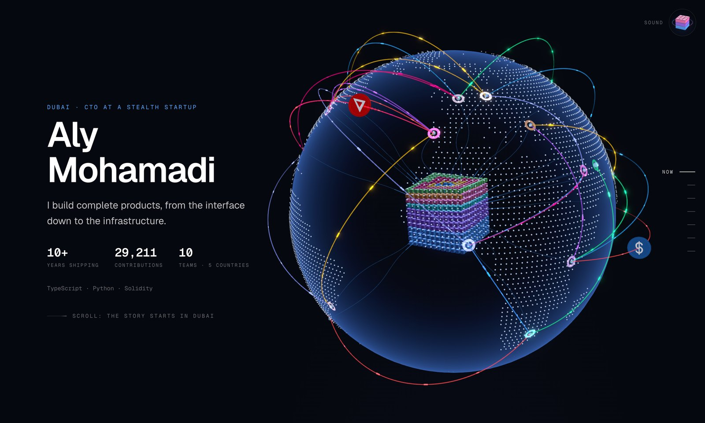

  <picture>
    <source media="(prefers-color-scheme: dark)" srcset="https://raw.githubusercontent.com/dev-aly3n/dev-aly3n/main/assets/hero-dark.svg?v=ceac7ea8">
    <source media="(prefers-color-scheme: light)" srcset="https://raw.githubusercontent.com/dev-aly3n/dev-aly3n/main/assets/hero-light.svg?v=ceac7ea8">
    
  </picture>

  
  
  
  

  <!--WEEK-->
  Last 7 days: <strong>453</strong> contributions
  <!--/WEEK-->

 

  
  <a href="https://aly3n.dev"><strong>aly3n.dev</strong></a>: my work as a 3D story you scroll through, with a soundtrack you play as you go.

### Building now

**Stealth startup** · CTO · May 2026 to now 
Building a new company from zero: the product, the systems under it, the infrastructure, and the
team. More when it launches.

**[4PITCH](https://4pitch.com)** · Product &amp; Technical Advisor · Feb 2025 to now 
Helping shape a platform that turns static pitch decks into living startup profiles.

**[Spila](https://www.spila.dev)** · Co-founder · 2020 to now 
Frontend and full-stack delivery for web3 teams. Led teams of 4 to 5 engineers across DEX,
lending and protocol frontends.

### Open source

**[aipager](https://github.com/dev-aly3n/aipager)** · Python · MIT 
Remote control for your AI coding agent over Telegram. Run Claude Code detached, then read output,
send prompts and approve permissions from your phone. Ships to PyPI, Homebrew, Nix and Docker. 

<!--RELEASES-->
Latest release <strong>v1.4.0</strong> on 30 Oct 2026 &#183; 75 releases so far
<!--/RELEASES-->

**[dtach-bin](https://github.com/dev-aly3n/dtach-bin)** · Python · GPL-2.0 
The `dtach` binary packaged as platform-specific Python wheels, so `pip install` just works on
Linux and macOS. 

### Selected work

**[iLayer](https://ilayer.io)** · Fullstack Engineer · Oct 2025 to Apr 2026 
Intent-based cross-chain execution layer on LayerZero V2. I built both sides: the solver bot that
quotes, fills and settles across five chains, and the [swap interface](https://swap.ilayer.io) on
top of it, plus the backend, servers and deployment pipeline. Ported the solver from NestJS to
Python/FastAPI.

**[Xoul.ai](https://xoul.ai)** · 2024 to 2026 
AI character platform. Real-time chat over Socket.io, WebRTC voice calls with PCM streaming, voice
cloning, and a media pipeline covering 10+ image and 4 video engines, plus the React Native app.

**[Kylix Finance](https://kylix.finance)** · 2024 to 2025 
Cross-chain lending on Polkadot. Built the on-chain package: type-safe custom RPC calls and
transaction hooks for supply, borrow, repay and liquidation bidding. Also the 3D landing page in
React Three Fiber.

**Ithil and Wizardex** · 2023 to 2024 
Led a five-person team delivering a fully on-chain orderbook DEX and a
crowdlending protocol frontend on Arbitrum.

Before 2020: JavaScript from 2019, and seven years of Joomla and WordPress platforms for clients before that.

### Stack

  <picture>
    <source media="(prefers-color-scheme: dark)" srcset="https://raw.githubusercontent.com/dev-aly3n/dev-aly3n/main/assets/stack-dark.svg?v=f027b3cc">
    <source media="(prefers-color-scheme: light)" srcset="https://raw.githubusercontent.com/dev-aly3n/dev-aly3n/main/assets/stack-light.svg?v=f027b3cc">
    
  </picture>

 

  <picture>
    <source media="(prefers-color-scheme: dark)" srcset="https://raw.githubusercontent.com/dev-aly3n/dev-aly3n/main/assets/stats-dark.svg?v=9ea379af">
    <source media="(prefers-color-scheme: light)" srcset="https://raw.githubusercontent.com/dev-aly3n/dev-aly3n/main/assets/stats-light.svg?v=9ea379af">
    
  </picture>

  Most of my work lives in private and organization repositories, so the public graph shows only part of it.

 

### Contact

I build products and help teams build them.

Reach me on [LinkedIn](https://www.linkedin.com/in/aly-mohamadi/) or [Telegram](https://t.me/aly3n), or take the tour at [aly3n.dev](https://aly3n.dev).
